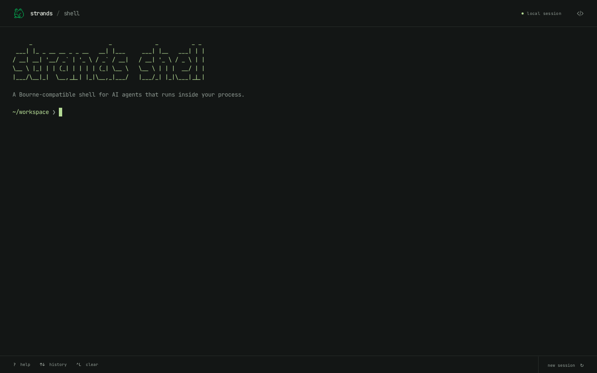

# Strands Shell, in your browser

A minimal terminal running the [Strands Shell](https://github.com/strands-agents/shell)
Rust core in a browser worker. Open the page and start typing. Commands, files,
and variables stay in the tab; the server serves static assets.



## Build and run

Install Node.js 22.12 or newer, [Rust](https://rustup.rs/), and
[wasi-sdk 34](https://github.com/WebAssembly/wasi-sdk/releases/tag/wasi-sdk-34).
Choose the SDK archive for your operating system and architecture, then unpack it.
The repository's `rust-toolchain.toml` selects Rust 1.96 and the WebAssembly target.

```sh
npm ci
export WASI_SDK_PATH=/absolute/path/to/wasi-sdk-34.0
npm run build
npm run preview -- --port 4173
```

Open `http://127.0.0.1:4173` in a current Chrome or Edge. The engine requires
WebAssembly JavaScript Promise Integration (JSPI); unsupported browsers show an
explanation in the terminal.

After the first build, use `npm run dev` for frontend work or `npm run build:site`
to rebuild just the site. Rebuild the engine with `npm run build:wasm` after changing
Rust or the component interface in `wit/`.

## Use

Try `ls`, `cat README.txt`, or `help`. The workspace includes sample logs, JSON,
and a word list. Pipes, redirection, shell variables, loops, and Lua use the real
shell engine.

| Input | Action |
| --- | --- |
| Enter | Run the command |
| Shift+Enter | Insert a newline |
| ↑ / ↓ | Browse history; ↓ past the newest entry restores the unfinished command |
| Tab | Complete common commands or files in the current directory |
| ← / →, Home / End | Move within the command |
| Ctrl+A / Ctrl+E | Move to the beginning / end |
| Ctrl+U / Ctrl+K | Delete before / after the cursor |
| Ctrl+W | Delete the previous word |
| Ctrl+L or `clear` | Clear the terminal |
| Ctrl+C | Cancel input, or stop execution and reset the workspace |
| `history` | Show this session's commands |
| `reset`, `exit`, or **new session** | Confirm before discarding the workspace |

Pasted scripts remain editable until Enter. Use normal terminal selection to copy
output. **Enable screen reader mode** is the first control in the page's tab order;
it becomes visible on keyboard focus. Motion follows the system's reduced-motion setting.

## Limits

- This is a command terminal, not a pseudoterminal: output arrives after a command
  finishes. Interactive input and fullscreen programs are unavailable.
- Reloading, resetting, stopping a running command, or reaching the five-second
  execution limit discards files and variables. Ctrl+C while editing only cancels
  the input.
- Network access and background jobs are disabled. There are no host filesystem
  mounts, credentials, native executables, or package managers.
- The engine caps input at 64 KiB, output at 128 KiB, each file at 1 MiB, and the
  filesystem at 512 inodes. These limits do not guarantee a total memory budget.
- Chromium is covered by automated browser checks. Other browsers are not verified.

## Verify

Keep the preview server running on port 4173, then run these checks in another terminal.

```sh
npm test
cargo fmt --check
cargo clippy --all-targets --locked -- -D warnings
npx playwright install chromium
npm run check:browser
```

Set `DEMO_ORIGIN` to test another preview URL. Browser checks cover shell state,
editing, completion, paste, Unicode, resizing, network denial, offline execution,
interruption, timeout, reset, and unsupported browsers. They save screenshots and
a report in `test-results/`.

GitHub Actions builds and tests the site and uploads `dist/` as `shell-demo-site`.
To host it, serve that directory with any static host that supports `.wasm` assets.
Relative asset paths support hosting under a subdirectory. No backend is required.

## Source

The browser adapter derives from the Strands Shell browser-terminal prototype.
`Cargo.toml` pins the upstream core to commit
`1d1a0aae9cf04e524687d3ed582b727a4b397ce2`; no neighboring checkout is required.
The adapter returns directory metadata for the prompt and completion without
running an extra shell command or changing `$?`.

[xterm.js](https://xtermjs.org/) renders the terminal. [Jco](https://github.com/bytecodealliance/jco)
adapts the WebAssembly component to the browser. JetBrains Mono and Space Grotesk
match the official site and are bundled locally; the page loads no external fonts.
Command output retains text colors but cannot change the clipboard, create
terminal hyperlinks, or reposition the cursor.

Licensed under Apache-2.0. To start developing, build once, run `npm run dev`, and
use `npm run check:browser` against a production preview before pushing.
