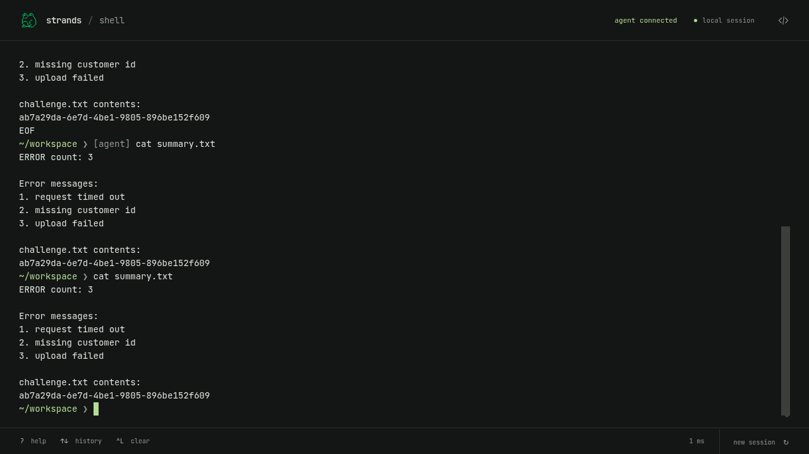

# Shared-folder agent experiment

A local coding agent can operate Strands Shell in a browser using a shared
folder. The website remains static. The agent uses its existing file-read and
file-write tools; no MCP server, extension, or relay is involved.

**The browser and agent must be able to access the same folder.** This fits a
local coding agent. An agent on a remote devbox cannot access a folder selected
on a laptop unless those machines already share that filesystem.

This is a throwaway prototype on `prototype/browser-agent`, separate from the
main demo. It uses the File System Access API in desktop Chrome or Edge.

## Try it

Build and serve the site using the [root instructions](../../README.md#build-and-run).
It uses the same static hosting as the original terminal and adds no dependencies.

1. Create an empty folder in a workspace your coding agent can read and write.
2. Open the demo and click **connect agent**.
3. Drag the folder into the panel, click **Connect**, and approve the browser's
   permission request.
4. Copy the displayed instructions into your agent. Give its full folder path
   if the agent cannot locate it.
5. Ask: “Count the errors in app.log, write a summary, and read it back.”

Watch the commands execute in the terminal. You can then type `cat summary.txt`
yourself. Keep the tab open and visible while the agent works.

The **choose a folder** button offers a picker alternative. The experiment
validated native folder drag-and-drop and the browser's real write-permission
prompt. The Linux test environment's native picker was unreliable, so that
alternative has not received the same validation.

## The connection

```text
Local agent ←→ selected folder ←→ browser page ←→ Strands Shell WASM worker
```

The page writes `AGENT.md`, which teaches the agent the protocol, and `session.json`,
which identifies the active session. The agent writes a command to `request.json`.
The page executes it and writes stdout, stderr, exit status, and working directory
to `response.json`. The agent sends one command at a time and waits for its
response. Within the active session, the page ignores repeated or older request
IDs. The page checks for requests every 300 milliseconds.

Only those four filenames are used. The folder carries messages and is not
mounted into the shell. The shell's files remain in memory, and its networking
remains disabled. The website makes no inference requests; the agent uses its
own model access.

The first connection requires an empty folder. Reconnecting a recognized session
folder replaces its transport files and preserves any extra files an agent left
there.

Any process that can write to the selected folder can submit commands while the
connection is active. Use a dedicated folder under your control. Disconnecting
ends command processing. Commands have a five-second limit. Reaching that limit,
stopping a running command, resetting, or reloading discards the shell workspace
and ends the connection.

## Observed results — November 5, 2026

A real Claude Code agent, restricted to its Read and Write tools, completed the
log-analysis task. It also read a random value created only in the browser shell
and included that value in its report. The browser was offline throughout
connection, execution, and manual verification: zero additional network requests.

The agent reported 21.3 seconds for its run and $0.0399 in model usage. These are
one test's measurements, not a general latency or cost estimate. The website has
no inference bill.

Twelve checks passed with real folder permission and a live agent. They covered
offline execution, terminal input preservation, duplicate IDs, wrong-session
requests, partial and replaced files, disconnect, reconnect, interruption, and
browser errors. Separate checks confirmed that unrelated or active folders are
rejected without writing files. The existing 39 browser checks and three
text-safety tests also passed.

The interruption check restored network access before resetting: starting a new
worker reloads the static engine assets. The [results](evidence.json) record the
completed run; the screenshot below shows the agent's report and manual verification.



## Other routes investigated

| Route | Result |
| --- | --- |
| Small model inside the tab | A 219 MB LFM2.5 350M model loaded through Wllama on CPU but failed the log task after six steps and 135 seconds. A 353 MB Qwen2.5 0.5B model exceeded the 240-token response limit without producing complete JSON. Neither tested configuration is suitable as the default. |
| Browser-provided model | The Chromium test build exposes `LanguageModel`, but its implementation returned an explicit echo stub rather than model inference. A genuine Chrome model was not validated here. |
| Direct provider calls with the visitor's account | OpenRouter documents a [sign-in flow for browser apps](https://openrouter.ai/docs/guides/overview/auth/oauth). This could keep the site static but adds provider setup; it was researched, not tested. |
| Scripted agent run | Can execute real shell commands without an LLM. It must be labeled as scripted. This remains an option for an instant introductory walkthrough; it is not the live agent demonstrated here. |

Use the shared-folder prototype to evaluate the local-agent experience. For
visitors without a local agent, an explicitly scripted walkthrough is a separate
follow-up rather than a reason to add service infrastructure.
